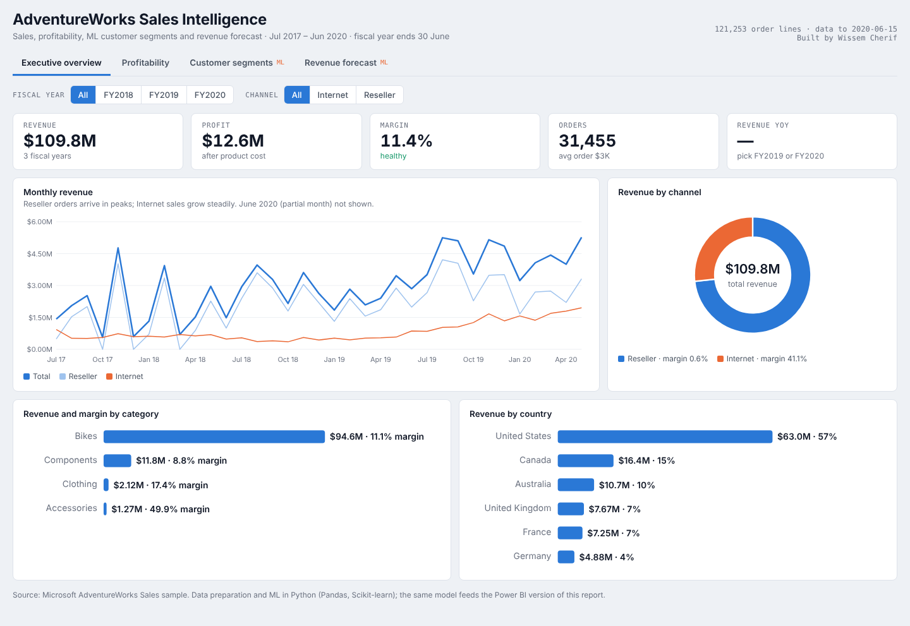
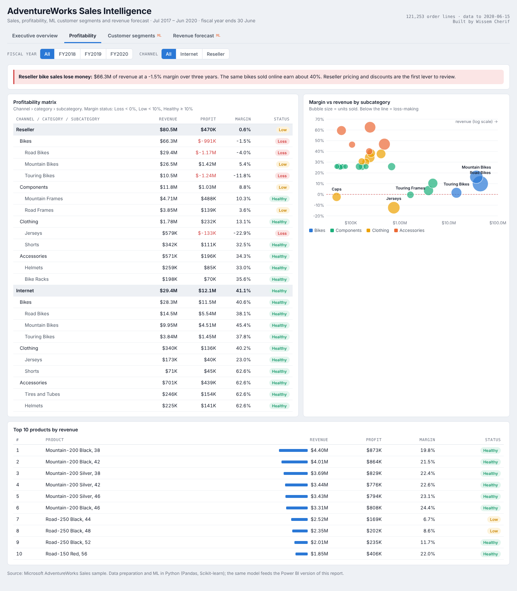
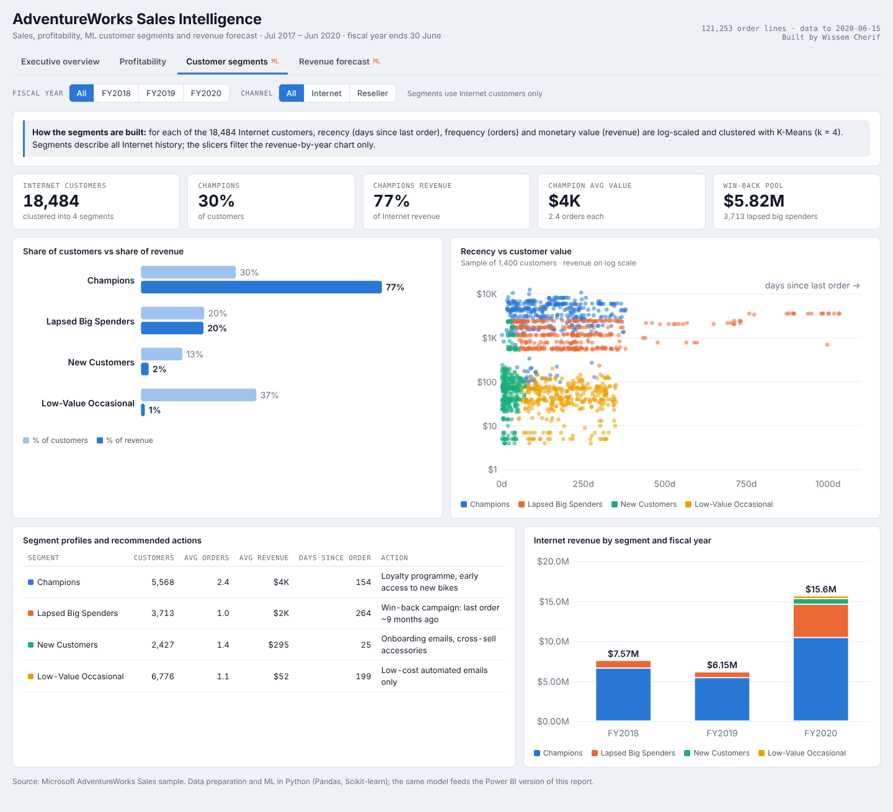
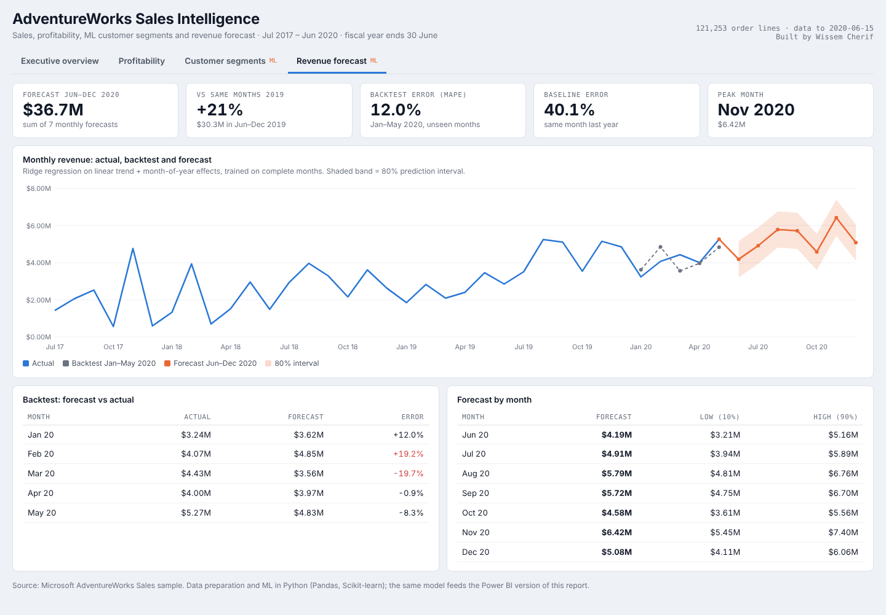
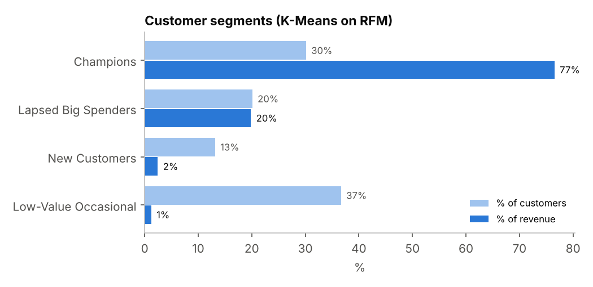
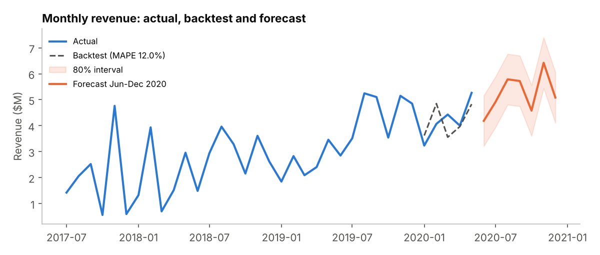

# Sales Intelligence: Power BI Dashboard + Machine Learning

An end-to-end analytics project on **$109.8M of sales** (121,253 order lines, Jul 2017 – Jun 2020):
a Python pipeline cleans the data, builds a star schema and adds two machine learning models,
and a 4-page Power BI report turns it into decisions.

**Tools:** Power BI (Power Query, star schema, DAX, time intelligence) · Python (Pandas, Scikit-learn) · K-Means · Regression forecasting
**Data:** [Microsoft AdventureWorks Sales sample](https://github.com/microsoft/powerbi-desktop-samples) (official Power BI sample)

## Architecture
```
AdventureWorks Sales.xlsx
        │
        ▼
ml/pipeline.py ─────────────────────────────────────────────┐
  1. data quality checks + star schema export                │
  2. ML #1  RFM features → K-Means → customer Segment         │
  3. ML #2  trend + seasonality model → 7-month forecast      │
        │                                                    │
        ▼                                                    │
powerbi/data/*.csv  (fact_sales, fact_forecast, dim_*)  ◄────┘
        │
        ▼
Power BI: Power Query → star schema → 29 DAX measures → 4 report pages
```

## Report pages
1. **Executive Overview**: revenue, profit, margin, orders, YoY growth, trend vs prior year, category and country mix
2. **Profitability**: margin by channel, category and subcategory, with loss-making lines flagged
3. **Customer Segments (ML)**: the K-Means segments with size, value and recency
4. **Revenue Forecast (ML)**: actuals, backtest and forecast with an 80% interval

## Interactive dashboard
**Live demo:** https://wissem02.github.io/sales-intelligence-powerbi-ml/dashboard/

The 4 report pages are also built as a self-contained interactive web dashboard (`dashboard/index.html`, no install needed):
fiscal-year and channel filters, hover tooltips, light and dark mode. It is generated from the same pipeline outputs by `dashboard/build_dashboard.py`.






## Key findings
| Finding | Figure |
|---|---|
| Revenue grew strongly each fiscal year (FY ends June; FY2020 data stops 15 June) | **+43%** FY2019, **+52%** FY2020 |
| Bikes drive the business | **86%** of revenue |
| **Reseller bike sales lose money** | **-1.5%** margin on **$66.3M** of revenue |
| Internet channel is far more profitable than resellers | **41.1%** vs **0.6%** margin |
| The United States is the main market | **57%** of revenue |

**Recommendation:** review reseller bike pricing and discounts first. The reseller channel brings 73% of revenue but almost no profit.

## ML #1: Customer segmentation (RFM + K-Means)
For the 18,484 Internet customers, the pipeline computes **Recency** (days since last order), **Frequency** (orders) and **Monetary** (revenue),
log-transforms and scales them, then clusters with K-Means (k = 4). Each segment is named with explicit rules on its profile.

| Segment | Customers | Avg orders | Avg revenue | Share of Internet revenue | Action |
|---|---|---|---|---|---|
| Champions | 5,568 (30%) | 2.4 | $4,035 | **77%** | Loyalty programme, early access |
| Lapsed Big Spenders | 3,713 (20%) | 1.0 | $1,568 | 20% | Win-back campaign (last order ~9 months ago) |
| New Customers | 2,427 (13%) | 1.4 | $295 | 2% | Onboarding, cross-sell accessories to bikes |
| Low-Value Occasional | 6,776 (37%) | 1.1 | $52 | 1% | Low-cost automated email only |



## ML #2: Monthly revenue forecast
A regression with a linear trend and month-of-year effects (Ridge) is trained on complete months.
- **Backtest:** trained to Dec 2019, predicting Jan–May 2020 gives a **12.0% MAPE**, vs **40.1%** for a "same month last year" baseline.
- **Forecast:** **$36.7M** for Jun–Dec 2020, with an 80% prediction interval exported for the Power BI chart.



## Data quality
121,253 order lines checked: 0 duplicate keys, 0 negative amounts, 0 lines without an order header.
2,113 lines have no ship date (orders not yet shipped); they are kept for revenue and flagged.

## Repository
```
ml/pipeline.py          data prep, star schema, segmentation, forecast
ml/charts.py            README charts
ml/results.json         every figure quoted in this README
dashboard/index.html    interactive 4-page dashboard (open in any browser)
dashboard/build_dashboard.py  rebuilds it from powerbi/data/
powerbi/data/           CSVs loaded by Power BI
powerbi/dax/measures.dax  all DAX measures
powerbi/theme.json      report colour theme
powerbi/BUILD_GUIDE.md  step-by-step report build
data/raw/               original Microsoft sample
```

## Run it
```bash
pip install pandas scikit-learn matplotlib openpyxl
python ml/pipeline.py   # rebuilds powerbi/data/ and ml/results.json
python ml/charts.py     # rebuilds the README charts
python dashboard/build_dashboard.py   # rebuilds the interactive dashboard
```
Then open Power BI Desktop and follow `powerbi/BUILD_GUIDE.md`, or open `powerbi/SalesIntelligence.pbix` and click Refresh.
